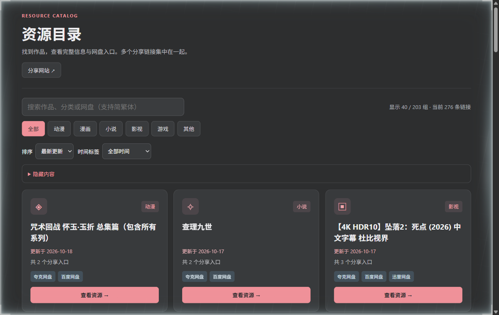

<h1 align="center">ACG 资源目录</h1>

用卡片集中浏览已有条目，按关键词和分类找到入口。

  
  

**[下载网页 ZIP](https://github.com/konghenfuxue-cpu/acg-resource-list/archive/refs/heads/main.zip) · [三步打开](#浏览目录) · [反馈问题](https://github.com/konghenfuxue-cpu/acg-resource-list/issues)**

解压后用浏览器打开 `index.html` 就能浏览。样式、数据和交互都在这个文件里，无需 Node.js、Python、构建或数据库。

## 实际效果

截图来自仓库页面在 Chrome 中的实际运行，不含浏览器地址栏或私人文件。条目数量与更新时间会随维护变化；截图不证明第三方链接始终有效。

## 浏览目录

| 步骤 | 操作 | 应该看到 |
| --- | --- | --- |
| 1 · 下载 | 点击上方 ZIP，或仓库绿色“Code → Download ZIP” | `acg-resource-list-main.zip`，不是 EXE 安装器 |
| 2 · 解压 | 等下载完成，右键“全部解压缩”；打开 `acg-resource-list-main` | `index.html` 与 `README.md` |
| 3 · 打开 | 双击 `index.html`，或右键选择 Chrome、Edge、Firefox | 资源目录、搜索框、分类和作品卡；点“查看资源”打开详情 |

本轮实测为 Windows 11 + Chrome。macOS 可双击 ZIP 解压后用现代浏览器打开，其他系统和浏览器未在本轮验收。

## 可以做什么

| 查找 | 浏览 | 按自己的习惯显示 |
| --- | --- | --- |
| 标题、分类和网盘关键词搜索，支持简繁体 | 分类、时间筛选，按更新或名称排序；卡片详情集中列出链接与说明 | 隐藏分类或标签，并恢复显示；手机与桌面自适应布局 |

基础目录可离线浏览。资源本身在第三方站点，打开链接仍需要网络，并受对应服务的登录、提取码与访问条件限制。

## 常见问题

**点开怎么是代码？** GitHub 上的 `index.html` 页面是在看源码。先下载并解压，再用浏览器打开本地 HTML；如果默认打开记事本，用“打开方式”换成浏览器。

**为什么卡片变少或搜不到？** 清空搜索，选全部分类、全部时间，并检查“隐藏内容”设置。

**页面会自动更新吗？** 本地文件是下载时的快照。重新下载 ZIP、解压到新目录并打开新版；保留旧文件即可回到旧快照。

**隐藏偏好保存在哪里？** 只保存在当前浏览器。本地文件存储支持由浏览器决定，换浏览器、目录或清理数据后不保证保留，不能当作收藏备份。

**网盘失效怎么办？** 记录条目名称和具体问题，通过页面反馈或仓库 Issue 提交。目录能打开不等于资源链接仍可访问。

完整使用、维护与恢复说明

## 使用与维护

### 浏览目录

适用 Windows、macOS 等能运行现代浏览器的系统；本轮实际检查为 Windows 11 + Chrome，其他系统未实测。没有 EXE 安装器，不需要 GitHub 账号、Node.js、Python 或数据库。

1. 在[仓库首页](https://github.com/konghenfuxue-cpu/acg-resource-list)确认分支为 `main`，选择绿色 **Code → Download ZIP**，得到 `acg-resource-list-main.zip`。这是网页文件包，不是安装程序。
2. 等下载完成，右键 ZIP → **全部解压缩**（macOS 双击解压）。打开 `acg-resource-list-main`，应直接看到 `index.html` 与 `README.md`。不要只在压缩软件预览窗口里打开。
3. 双击 `index.html`；如果启动的是文本编辑器，右键 → 打开方式 → Chrome、Edge 或 Firefox。预期出现“资源目录”、搜索框、分类按钮和作品卡片。它从本地文件加载，初始数量随仓库内容变化。
4. 在搜索框输入一个当前卡片标题中的词，结果应缩小；点“查看资源”弹出详情，查看链接标签与说明，再关闭弹窗。清空搜索并选“全部”可回到完整目录。打开详情不需要先访问网盘。
5. 可试着选择一个分类、切换名称排序，或展开“隐藏内容”调整偏好。找不到条目时先清空搜索、选全部分类/全部时间，再在隐藏设置中恢复显示。

资源链接会跳转到第三方站点；目录页面本身不是文件存储或下载服务，链接可用性与访问条件由对应站点决定。

本地 `index.html` 保存的是下载时的目录快照；不会自动更新，也不包含网盘中的资源文件。打开第三方链接可能需要联网、登录、提取码或对应客户端，应按第三方服务说明处理。链接失效与目录页面运行失败是不同问题，反馈时写清条目和现象。

#### 文件、偏好与更新

网页文件留在你解压的位置。隐藏偏好仅存于当前浏览器；本地 `file://` 页面上的存储支持与范围由浏览器决定，换浏览器、换目录或清理数据后不保证保留。不要依靠它作为收藏备份。

更新时重新下载 ZIP 并解压到新文件夹，先打开新版确认搜索和弹窗可用，再决定是否移走旧版。想回到旧目录内容时打开保留的旧 `index.html`。无需卸载程序；删除前保存自己编辑过的网页副本。

| 遇到的问题 | 处理 |
| --- | --- |
| 显示 HTML 代码 | 用浏览器打开实际的 `index.html`；不要把 GitHub 的源码展示页当运行页面。 |
| 空白或按钮没反应 | 完整解压后用当前稳定版浏览器重新打开；确认 JavaScript 未被禁用。保留旧文件，重新下载到新目录作对照。 |
| 下载后没有看到 HTML | 在资源管理器开启“显示文件扩展名”；应是 `index.html`，不是保存成 `index.html.txt` 的文本。 |
| 搜不到/卡片变少 | 清空搜索、恢复全部分类和时间，并检查隐藏设置。 |
| 浏览器阻止复制、下载二维码或保存偏好 | 按页面提供的手动复制方式操作；基础浏览不要求放宽浏览器全局安全设置。 |

2026-10-19 实际浏览器检查覆盖本地文件加载、搜索与详情交互；未检查所有第三方链接，也未下载目录中的资源。页面自带全部样式与脚本，基础浏览可离线使用，第三方目标仍需联网。

### 修改自己的目录

使用文本编辑器打开 `index.html`，参考现有条目修改资源数据。页面 CSS 与 JavaScript 也在同一文件中，适合小规模维护；修改后刷新浏览器，核对搜索、筛选、详情弹窗与链接。

公开发布前，也请检查页面中的群组、反馈、分享地址及二维码是否仍指向你希望使用的目标。

### 部署为静态页面

将 `index.html` 放到支持静态 HTML 的托管服务即可；无需后端。仓库当前仅包含页面文件，没有单独的构建流程或自动测试套件。

## 反馈与内容说明

失效链接和条目问题可通过页面已有反馈入口，或在本仓库 [Issues](https://github.com/konghenfuxue-cpu/acg-resource-list/issues) 中说明条目名称与问题。

目录收录不代表对第三方内容、版权状态或安全性的保证。作品和第三方服务的权利归各自权利人；公开分享时应确认相应授权。

当前仓库未附独立的开源许可证；公开可见不等于已获得任意复制、修改和再分发授权。

## 来源、反馈与使用范围

目录页面与交互代码位于 [index.html](index.html)，问题可通过 [Issue](https://github.com/konghenfuxue-cpu/acg-resource-list/issues)反馈。仓库目前未单独声明开源许可证；第三方资源及品牌归各自权利人，收录链接不代表取得再分发授权，也不保证长期有效。
